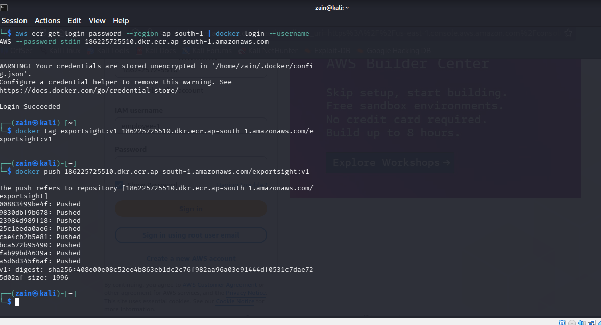

# ExportSight — Dockerized & Published to AWS ECR

  

**Local to Cloud Containerization — Docker & AWS ECR**

ExportSight is a Business Intelligence dashboard for small export businesses (orders, payments, profitability, PDF reports), built with Streamlit, Pandas, Plotly and SQLite. This repository contains the full application together with its production-style Docker packaging and proof of its published image on **Amazon Elastic Container Registry (ECR)**.

---

## What was done

- **Multi-stage Dockerfile** (`python:3.12-slim`) — a builder stage installs dependencies into an isolated prefix; the final image copies only the installed packages and the app, keeping the runtime image lean.
- **Non-root runtime** — the container runs as a dedicated `appuser`, not root.
- **Healthcheck** — Docker `HEALTHCHECK` polls Streamlit's `/_stcore/health` endpoint every 30s.
- **Clean build context** — `.dockerignore` excludes caches, tests, docs and the local database from the image build.
- **Local verification** — image built and the container run locally; the dashboard was verified in the browser on `localhost:8501` before publishing.
- **Published to AWS ECR** — repository `exportsight` in region `ap-south-1` (Mumbai), authenticated with an IAM user via `aws ecr get-login-password`; image tagged and pushed as `v1`.

**Push digest (proof):**
```
v1: digest: sha256:408e00e08c52ee4b863eb1dc2c76f982aa96a03e91444df0531c7dae725d02af size: 1996
```

## Tech stack

Docker · AWS ECR · AWS CLI & IAM · Python 3.12 · Streamlit · Pandas · Plotly · SQLite

## Run it locally

Build and run from source:

```bash
docker build -t exportsight:v1 .
docker run -d --name exportsight-app -p 8501:8501 exportsight:v1
# open http://localhost:8501
```

Or pull the published image (ECR repository is private — an authenticated AWS session for the account is required):

```bash
aws ecr get-login-password --region ap-south-1 | docker login --username AWS --password-stdin 186225725510.dkr.ecr.ap-south-1.amazonaws.com
docker pull 186225725510.dkr.ecr.ap-south-1.amazonaws.com/exportsight:v1
docker run -d --name exportsight-app -p 8501:8501 186225725510.dkr.ecr.ap-south-1.amazonaws.com/exportsight:v1
```

Without Docker:

```bash
pip install -r requirements.txt
streamlit run app.py
```

## Project structure

```
├── Dockerfile            # multi-stage build (builder + slim runtime, non-root)
├── .dockerignore
├── app.py                # Streamlit entry point
├── modules/              # dashboard pages: overview, orders, payments, profitability, reports, settings
├── db/                   # SQLite schema, seeding and data-access layer
├── utils/                # finance calculations, validation, PDF report generation
├── tests/                # pytest suite (37 tests)
├── data/samples/         # sample import files (CSV/Excel)
├── FEATURES.md           # application feature list
├── DEPLOYMENT.md         # deployment notes
└── screenshots/          # build/push proof
```

## Screenshots

**ECR push — `docker login`, `docker tag` and `docker push` completing with the final digest:**



## Notes

- The data shipped with this project is **fictional demo data** (a sample textile exporter) created for demonstration purposes.

## Author

**Zain Ul Abdin** — Founder, **Zain Tech Automation Solutions**, Karachi, Pakistan
GitHub: [@zain-ul-abadeen-1213](https://github.com/zain-ul-abadeen-1213)
